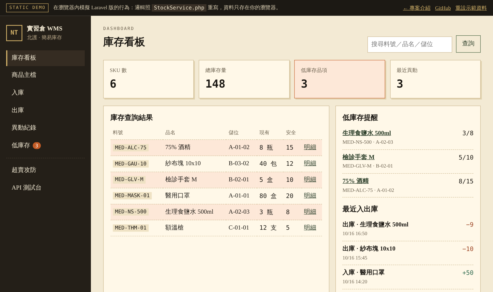
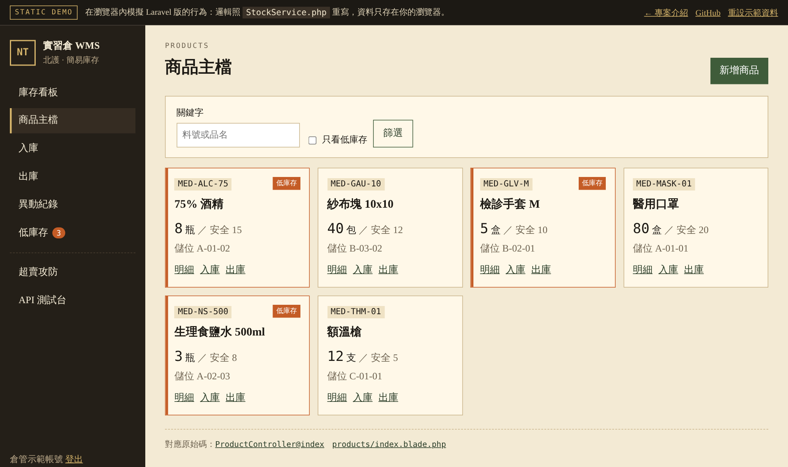
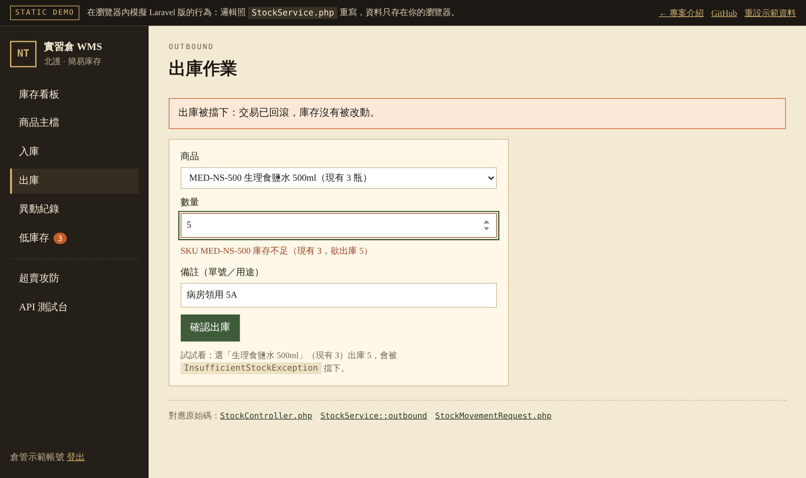

# PHP 最小範圍 ＋ 48 小時簡易庫存 WMS

🌐 **專案介紹**：https://tai-ju.github.io/php-inventory-wms/
⚡ **互動 Demo**：https://tai-ju.github.io/php-inventory-wms/demo.html（瀏覽器內模擬入出庫、超賣防護與 API）

對應目標：看懂 PHP、能改小型 CRUD，並用 Laravel 做出可貼 GitHub 的庫存系統（商品、入庫、出庫、查詢、低庫存）。情境贴近倉儲／MES 的「料號、儲位、安全庫存」。

> 需要 PHP 8.2+ 與 Composer。Windows 建議用 [Laravel Herd](https://herd.laravel.com/windows)，內建 PHP 與 Composer。

## 資料夾

| 路徑 | 用途 |
| --- | --- |
| [`learn/`](learn/README.md) | PHP／Web／PDO／安全必學範例 |
| [`inventory-wms/`](inventory-wms/) | Laravel 12 庫存系統（Blade + MySQL/SQLite） |
| [`docs/API.md`](docs/API.md) | REST API 文件 |
| [`docs/screenshots/`](docs/screenshots/) | 放 README 用截圖 |

## 必學最小範圍（先會這些再寫 Laravel）

**PHP：** 變數、陣列、`foreach`、函式、條件、OOP、例外。  
**Web：** GET／POST、表單、Session／Cookie、HTTP 狀態碼。  
**資料庫：** PDO Prepared Statements（面試常問 SQL Injection）。  
**Laravel：** MVC、Route、Controller、Blade、Eloquent、Migration、Form Request、Middleware。  
**安全：** CSRF、XSS、SQL Injection、密碼雜湊。

對照實作位置：見 [`learn/README.md`](learn/README.md)。

## 環境（Windows）

1. 安裝 [XAMPP](https://www.apachefriends.org/)（PHP 8.2+、MySQL）或獨立 PHP 8.2。
2. 安裝 [Composer](https://getcomposer.org/)。
3. 把 `C:\xampp\php` 加進 PATH，新開終端機執行 `php -v`、`composer -V`。

本專案預設 **SQLite**，沒開 MySQL 也能先跑。要改 MySQL：建立資料庫 `inventory_wms`，並改 `inventory-wms/.env`。

## 48 小時怎麼排

### 第 0–6 小時：語法能跑

把 `learn/01`～`06` 逐檔執行，改數字、改條件，直到你能自己寫「庫存不足就拒絕出庫」。

### 第 6–12 小時：Web + PDO

跑 `07`～`11`。重點記住四句話：

- 查詢用 GET，寫入用 POST。
- 登入狀態放 Session，不要把密碼放 Cookie。
- SQL 永遠用綁定參數，不要把使用者輸入接進字串。
- 輸出 HTML 用跳脫（Blade 的 `{{ }}`），表單加 CSRF。

### 第 12–36 小時：把庫存系統跑起來並讀程式

在 `inventory-wms/`：

```bash
cd inventory-wms
copy .env.example .env
composer install
php artisan key:generate
php artisan migrate --seed
php artisan serve
```

瀏覽器開啟 http://127.0.0.1:8000

> **Windows 小提醒**
> - 也可以直接點兩下 `inventory-wms/setup.bat`，一次完成安裝、建表、測試與啟動。
> - 若 `php artisan serve` 出現 `Failed to listen on 127.0.0.1:8000 (reason: ?)`，改用 PHP 內建伺服器：
>   ```powershell
>   cd public; php -S 127.0.0.1:8000 ..\vendor\laravel\framework\src\Illuminate\Foundation\resources\server.php
>   ```
> - 專案不建議放在 OneDrive 同步資料夾內，SQLite 檔可能被鎖住。

示範帳號：`warehouse@example.com` / `password`  
API Token：`demo-api-token`（見 [`docs/API.md`](docs/API.md)）

請自己點完這條路，並對照原始碼：

1. 登入（Session、CSRF、`password` hashed cast）
2. 看板查庫存、看低庫存紅字
3. 新增商品 → 編輯 → 入庫 → 出庫（數量大於庫存應被擋）
4. 異動紀錄
5. 用 curl 打 `/api/stock/low`

對應檔案：

- Route：`inventory-wms/routes/web.php`、`routes/api.php`
- Controller：`app/Http/Controllers/*`
- Validation：`app/Http/Requests/*`
- Eloquent：`app/Models/Product.php`、`StockMovement.php`
- 入出庫交易：`app/Services/StockService.php`
- Migration：`database/migrations/*`
- Middleware：`app/Http/Middleware/Authenticate.php`、`VerifyApiToken.php`
- Blade：`resources/views/*`

### 第 36–48 小時：GitHub 展示包

1. 截四張圖放到 `docs/screenshots/`（說明見該資料夾）。
2. 把本 README 的截圖區塊取消註解並改路徑。
3. 建立 repo、推上去（不要提交 `.env`）。
4. README 寫：功能、如何安裝、帳號、API 連結、你改過哪一段。

```bash
git init
git add .
git commit -m "Add PHP learning path and Laravel inventory WMS"
```

## 功能清單

- 商品列表／新增／編輯／刪除
- 入庫、出庫（交易＋列鎖，避免超賣）
- 庫存查詢（料號、品名、儲位）
- 低庫存提醒（現有量 ≤ 安全庫存）
- 登入／註冊、Bearer API

## 畫面截圖

（跑起來後貼上）

<!--




-->

## 安全對照

| 風險 | 作法 |
| --- | --- |
| CSRF | Blade `@csrf`；Laravel web 中介層驗證 |
| XSS | `{{ $name }}` 自動跳脫；不要用 `{!! !!}` 輸出使用者輸入 |
| SQL Injection | Eloquent / Query Builder，不拼接 SQL |
| 密碼 | `User` 的 `hashed` cast（底層 `password_hash`） |
| API Token | 資料庫只存 SHA-256，不明文存放 |

## MySQL（可選）

```sql
CREATE DATABASE inventory_wms CHARACTER SET utf8mb4 COLLATE utf8mb4_unicode_ci;
```

`.env`：

```
DB_CONNECTION=mysql
DB_HOST=127.0.0.1
DB_PORT=3306
DB_DATABASE=inventory_wms
DB_USERNAME=root
DB_PASSWORD=
```

然後 `php artisan migrate --seed`。
