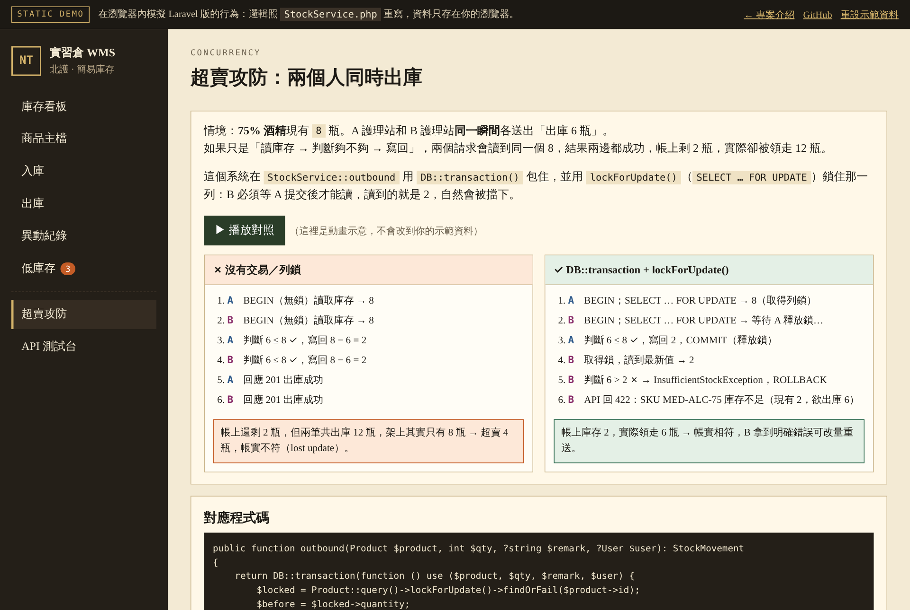

# 實習倉 WMS｜醫材簡易庫存管理系統

以 **Laravel 12** 開發的庫存管理系統，涵蓋商品主檔、入庫／出庫、低庫存提醒、異動稽核，以及一組 Bearer Token REST API。

🌐 **專案介紹**：https://tai-ju.github.io/php-inventory-wms/  
⚡ **互動 Demo**：https://tai-ju.github.io/php-inventory-wms/demo.html


---

## 為什麼做這個專案

我的背景在醫療院所，這個專案以醫院的醫材倉儲為情境，用 PHP／Laravel 做出一個小型庫存系統，資料欄位對應倉儲／MES 常見的「料號、儲位、安全庫存」。目的是熟悉 Laravel 的開發方式，同時處理庫存系統最核心的問題：**多人同時出庫時，帳不能錯。**

## 畫面

| 庫存看板 | 商品主檔 |
| --- | --- |
|  |  |
| **出庫超量被擋下** | **超賣攻防：有鎖 vs 沒鎖** |
|  |  |

> 截圖取自[互動 Demo](https://tai-ju.github.io/php-inventory-wms/demo.html)，介面與 Laravel 版相同。

## 功能

- **商品主檔**：新增、編輯、刪除，料號唯一；新商品庫存從 0 開始，只能透過入庫增加
- **入庫／出庫**：每筆都寫入異動紀錄，保留「異動前 → 異動後」數量與經手人，方便稽核
- **防止超賣**：出庫數量大於現有量會被擋下；多人同時出庫也不會讓帳實不符（見下方說明）
- **低庫存提醒**：現有量 ≤ 安全庫存時標紅，看板與側欄顯示件數
- **庫存查詢**：依料號、品名、儲位搜尋；異動紀錄可篩選入庫／出庫
- **REST API**：7 個端點，Bearer Token 驗證，詳見 [`docs/API.md`](docs/API.md)

## 技術重點

### 1. 交易＋列鎖，避免同時出庫造成超賣

庫存 8 瓶，兩個人同時各出庫 6 瓶。如果只是「讀取 → 判斷 → 寫回」，兩個請求都會讀到 8、都判斷成功，帳上剩 2 瓶，實際上卻超賣了。

所有入出庫都集中在 [`StockService`](inventory-wms/app/Services/StockService.php)，用 `DB::transaction()` 包住，並以 `lockForUpdate()`（`SELECT … FOR UPDATE`）鎖住該商品：第二個請求必須等第一個提交後才能讀取，讀到的是最新的 2，於是被 `InsufficientStockException` 擋下並回滾。

```php
return DB::transaction(function () use ($product, $qty, $remark, $user) {
    $locked = Product::query()->lockForUpdate()->findOrFail($product->id);
    $before = $locked->quantity;

    if ($qty > $before) {
        throw InsufficientStockException::for($locked->sku, $before, $qty);
    }

    $locked->quantity = $before - $qty;
    $locked->save();
    // 寫入 stock_movements（before_qty / after_qty）
});
```

### 2. 分層：網頁與 API 共用同一套規則

```
Route → Middleware → Form Request → Controller → StockService → Eloquent → DB
                                                       │
                                     Blade 畫面（Web） ┴ JSON（API）
```

- 驗證規則集中在 Form Request（`ProductRequest`、`StockMovementRequest`）
- 商業邏輯集中在 `StockService`，Controller 只負責接收請求與回應
- 因此網頁表單與 API 的入出庫行為保證一致

### 3. 安全

| 風險 | 作法 |
| --- | --- |
| SQL Injection | 全部透過 Eloquent／Query Builder（底層 PDO Prepared Statements），不拼接 SQL |
| XSS | Blade `{{ }}` 自動跳脫，不以 `{!! !!}` 輸出使用者輸入 |
| CSRF | 表單帶 `@csrf`，由 web 中介層驗證 |
| 密碼 | `User` 模型的 `hashed` cast（bcrypt） |
| API Token | 資料庫只存 SHA-256 雜湊，不存明文 |

### 4. 測試

[`tests/Feature/InventoryFlowTest.php`](inventory-wms/tests/Feature/InventoryFlowTest.php) 涵蓋：未登入導向、建立商品並入出庫、出庫超量被拒絕。

## 專案結構

```
inventory-wms/
├── app/
│   ├── Http/Controllers/     Dashboard、Product、Stock、Auth、Api/InventoryApi
│   ├── Http/Middleware/      Authenticate、VerifyApiToken
│   ├── Http/Requests/        ProductRequest、StockMovementRequest
│   ├── Models/               Product、StockMovement、User
│   ├── Services/             StockService（入出庫交易）
│   └── Exceptions/           InsufficientStockException
├── database/migrations/      products、stock_movements 等資料表
├── resources/views/          Blade 畫面
├── routes/                   web.php、api.php
└── tests/Feature/            功能測試
docs/                         API 文件、GitHub Pages（介紹頁與互動 Demo）
learn/                        開發前的 PHP 基礎練習（見 learn/README.md）
```

## 安裝與執行

需要 **PHP 8.2+** 與 **Composer**。Windows 建議安裝 [Laravel Herd](https://herd.laravel.com/windows)，已內建 PHP 與 Composer。

```bash
git clone https://github.com/Tai-Ju/php-inventory-wms
cd php-inventory-wms/inventory-wms
cp .env.example .env          # Windows：copy .env.example .env
composer install
php artisan key:generate
php artisan migrate --seed    # 預設 SQLite，免安裝資料庫
php artisan test
php artisan serve
```

開啟 http://127.0.0.1:8000

- 示範帳號：`warehouse@example.com` / `password`
- API Token：`demo-api-token`

<details>
<summary>Windows 注意事項</summary>

- 可直接點兩下 `inventory-wms/setup.bat`，一次完成安裝、建表、測試與啟動。
- 若 `php artisan serve` 出現 `Failed to listen on 127.0.0.1:8000 (reason: ?)`，改用 PHP 內建伺服器：
  ```powershell
  cd public; php -S 127.0.0.1:8000 ..\vendor\laravel\framework\src\Illuminate\Foundation\resources\server.php
  ```
- 專案不建議放在 OneDrive 等同步資料夾，SQLite 檔可能被鎖住。

</details>

<details>
<summary>改用 MySQL</summary>

```sql
CREATE DATABASE inventory_wms CHARACTER SET utf8mb4 COLLATE utf8mb4_unicode_ci;
```

修改 `inventory-wms/.env`：

```
DB_CONNECTION=mysql
DB_HOST=127.0.0.1
DB_PORT=3306
DB_DATABASE=inventory_wms
DB_USERNAME=root
DB_PASSWORD=
```

再執行 `php artisan migrate --seed`。在 MySQL InnoDB 下，`lockForUpdate()` 會是真正的列鎖。

</details>

## API 範例

```bash
curl -H "Authorization: Bearer demo-api-token" http://127.0.0.1:8000/api/stock/low

curl -X POST http://127.0.0.1:8000/api/stock/out \
  -H "Authorization: Bearer demo-api-token" \
  -H "Content-Type: application/json" \
  -d '{"product_id": 6, "quantity": 5, "remark": "病房領用"}'
# 庫存不足 → 422 {"message": "SKU MED-NS-500 庫存不足（現有 3，欲出庫 5）"}
```

完整端點與狀態碼見 [`docs/API.md`](docs/API.md)，也可以在 [Demo 的 API 測試台](https://tai-ju.github.io/php-inventory-wms/demo.html#/api)直接送請求。

## 後續可以加強

- 角色權限（倉管／領用單位／主管）與出庫審核
- 批號與效期管理（先進先出、近效期提醒）
- 盤點作業與盤差調整
- 以排程或 Webhook 在低庫存時自動通知

---

示範資料皆為虛構。
